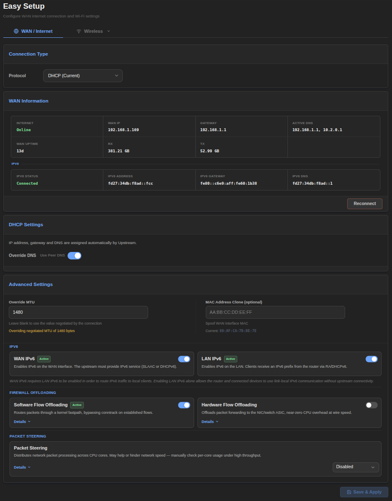
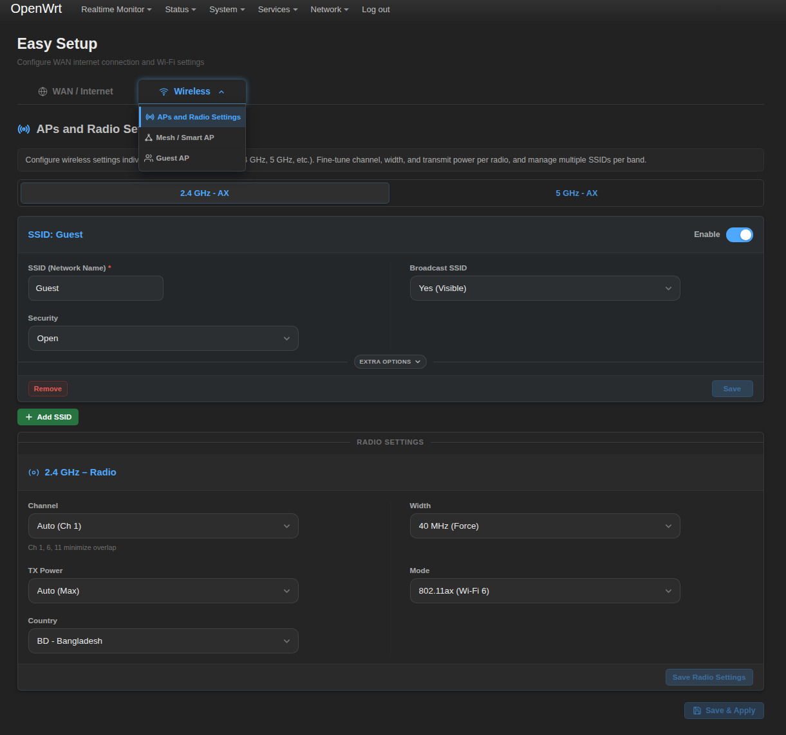

# LuCI Easy Setup

WAN, wireless, access point, guest network, and Smart AP management in a single streamlined interface for OpenWrt LuCI. No external services or build tools required.

**Official upstream repository for the OpenWrt luci-app-easy-setup package.**

---

## Installation

After installation, navigate to **Network → Easy Setup** in the LuCI web interface.

### For OpenWrt v25.12 or newer (.apk)

```
apk update && \
wget --no-check-certificate -O /tmp/luci-app-easy-setup.apk "https://github.com/OppsError404/luci-app-easy-setup/releases/download/v2.0.1-r1/luci-app-easy-setup-2.0.1-r1.apk" && \
apk add --allow-untrusted /tmp/luci-app-easy-setup.apk && \
rm -f /tmp/luci-app-easy-setup.apk
```

### For OpenWrt v24.10.5 or older (.ipk)

```
opkg update && \
wget --no-check-certificate -O /tmp/luci-app-easy-setup.ipk "https://github.com/OppsError404/luci-app-easy-setup/releases/download/v2.0.1-r1/luci-app-easy-setup_2.0.1-r1.ipk" && \
opkg install /tmp/luci-app-easy-setup.ipk && \
rm -f /tmp/luci-app-easy-setup.ipk
```

## Uninstallation

### For OpenWrt v25.12 or newer (.apk)

```
apk del luci-app-easy-setup
```

### For OpenWrt v24.10.5 or older (.ipk)

```
opkg remove luci-app-easy-setup
```

---

## Features

`luci-app-easy-setup` consolidates five router configuration panels into a tab-driven LuCI interface — WAN, Radio, Access Points, Guest Network, and Smart AP. Native rpcd ucode registration delegates requests to isolated ucode workers; ucode-rendered templates keep the existing custom interface. Workers use OpenWrt's UCI, ubus and filesystem bindings without a separate Lua runtime.

### WAN Configuration

-   **Connection type switching** — DHCP, PPPoE, or Static IP without losing existing interface config
-   **PPPoE auth failure diagnosis** — detects authentication errors and displays a clear message
-   **WAN IPv6 auto-config** — enables/disables DHCPv6 client on the WAN interface
-   **LAN IPv6 toggle** — enables/disables DHCPv6 server + router advertisements on LAN
-   **DNS management** — add/remove custom DNS servers with automatic validation
-   **MAC address override** — set custom WAN MAC address
-   **MTU configuration** — per-protocol MTU with safe defaults
-   **Flow Offloading** — software (SW) and hardware (HW) offload with mutual exclusion
-   **Packet Steering** — 0 (auto), 1 (enabled), or 2 (forced) RPS steering
-   **WAN port detection** — auto-detects the physical WAN port from switch topology
-   **Reconnect** — one-click WAN reconnect with status feedback
-   **Interface deletion** — safely remove orphaned interfaces (wan_6, wan_6 on no-IPv6 WAN)

### Radio Settings

-   **Per-band panels** — independent configuration for 2.4 GHz, 5 GHz, and 6 GHz radios
-   **Channel selection** — populates available channels from hardware capability (iwinfo)
-   **Channel width** — 20/40/80/160 MHz with hardware support detection
-   **TX power** — slider control from 0 to max hardware capability (dBm)
-   **Country code** — searchable dropdown with ISO country list
-   **Wi-Fi mode** — 802.11 b/g/n/ac/ax/be with backward compatibility detection

### Access Points (SSID Management)

-   **Per-band SSID cards** — add, edit, and delete SSIDs independently on each radio
-   **Security modes** — Open, WPA-PSK, WPA2-PSK, WPA3-SAE, WPA2/WPA3 mixed
-   **WPA3 detection** — binary probe for SAE support on the running wpad
-   **Password show/hide** — eye toggle with visual confirmation
-   **Roaming** — 802.11r fast roaming toggle (per SSID)
-   **AP Isolation** — prevent client-to-client communication (per SSID)
-   **WNM** — 802.11v wireless network management (per SSID)
-   **Extra options** — expandable section for roaming/isolation/WNM on each SSID card

### Guest Network

-   **Master enable toggle** — enable/disable the entire guest network
-   **Per-band SSID and key** — independent guest SSID, encryption, and password per radio
-   **AP Isolation** — per-band client isolation within the guest network
-   **VLAN configuration** — per-band VLAN ID override (defaults to automatic)
-   **Auto DHCP pool** — automatically provisions a dedicated DHCP range for guests
-   **DHCP pool fields** — start IP, end IP, DNS, lease time with validation
-   **Auto firewall rules** — creates forwarding rules and isolation zones
-   **Subnet conflict detection** — warns if guest subnet overlaps with existing networks
-   **Fix Dependencies** — one-click repair of broken guest firewall/DHCP/network config
-   **Per-band deletion** — remove individual guest bands without affecting others

### Smart AP

-   **Cross-band unified SSID** — create a single SSID that spans 2.4 GHz, 5 GHz, and 6 GHz
-   **WPA3 detection with warning** — alerts if the running wpad lacks SAE support
-   **Per-band SSID/key/encryption** — independent settings per band within the unified setup
-   **Roaming/isolation/WNM** — per-band toggles for 802.11r, client isolation, 802.11v
-   **Candidate detection** — scans all radios and shows only available bands
-   **Config mismatch indicator** — highlights when band configs differ from recommended defaults
-   **Dirty-tracking** — batch-save only modified bands
-   **Per-AP deletion** — remove individual Smart AP entries

---

## Usage

### Web Interface

Navigate to **Network → Easy Setup** in the LuCI menu. The interface is organized into five tabs:

-   **WAN** — Internet connection settings
-   **Radio** — Wireless radio configuration
-   **Access Points** — SSID management per band
-   **Guest** — Guest network provisioning
-   **Smart AP** — Cross-band unified SSIDs

### Service Commands

```
/etc/init.d/easy_setup start        # Decompress gzip assets to /tmp
/etc/init.d/easy_setup stop         # Remove asset symlinks
/etc/init.d/easy_setup restart      # Restart service
/etc/init.d/easy_setup enable       # Enable at boot
/etc/init.d/easy_setup disable      # Disable at boot
```

---

## Configuration

No UCI configuration file is required. The app reads and writes to the standard OpenWrt UCI config files:

| UCI Config | Purpose |
|---|---|
| `/etc/config/network` | WAN interface, IPv6, DNS, MAC, MTU |
| `/etc/config/wireless` | Radio channels, SSIDs, security, guest, Smart AP |
| `/etc/config/firewall` | Guest network forwarding and isolation zones |
| `/etc/config/dhcp` | Guest network DHCP pool |

Compressed assets are unpacked into `/tmp/luci-static/resources/view/easy_setup/`. Capability/reachability caches and private operation snapshots live in `/tmp/easy_setup/`; all reset on reboot.

## Dependencies

### Required

| Package | Notes |
|---|---|
| `luci-base` | LuCI framework; supplies native ucode, fs/UCI/ubus bindings and rpcd file/ucode plugins |
| `rpcd-mod-iwinfo` | Hardware-aware wireless channels, modes, TX power, signal, and capability data |
| `ip-bridge` | VLAN-aware bridge FDB inspection for physical uplink-port detection |

### Optional

| Package | Notes |
|---|---|
| `wpad` (full variant) | Required for WPA3-SAE, 802.11r, and 802.11v support |

`rpcd-mod-iwinfo` remains explicit even when another LuCI module happens to install it transitively. Generic channel, mode and TX-power fallbacks do not provide equivalent hardware/regulatory data. `ip-bridge` remains declared: falling back to a bridge device is not equivalent to resolving its VLAN-aware physical uplink member.

The native backend no longer requires `lua`, `luci-lib-jsonc`, `luci-lib-nixio`, `libubus-lua` or `libuci-lua`. Other installed packages may still need them; removing Easy Setup's dependency declarations is not a recommendation to uninstall shared libraries indiscriminately. The SDK also adds the standard `libc` dependency to the built APK.

---

## URLs

```
/cgi-bin/luci/admin/network/easy_setup          # WAN page
/cgi-bin/luci/admin/network/easy_setup/radio    # Radio settings
/cgi-bin/luci/admin/network/easy_setup/aps      # Access Points
/cgi-bin/luci/admin/network/easy_setup/guest    # Guest network
/cgi-bin/luci/admin/network/easy_setup/smart_ap # Smart AP
/ubus  →  easy_setup.*                          # JSON API (28 ubus methods)
```

---

## Screenshots

### WAN Configuration Interface


### Unified Wireless Options


---

## License

MIT license.

## Support

Report issues with:
-   OpenWrt version and hardware platform
-   Steps to reproduce

## See Also

-   [luci-app-dashboard](https://github.com/OppsError404/luci-app-dashboard) - Realtime system monitoring dashboard and vnStat backup manager.
-   [luci-app-client-monitor](https://github.com/OppsError404/luci-app-client-monitor) - Real-time per-client traffic monitoring and bandwidth tracking.
